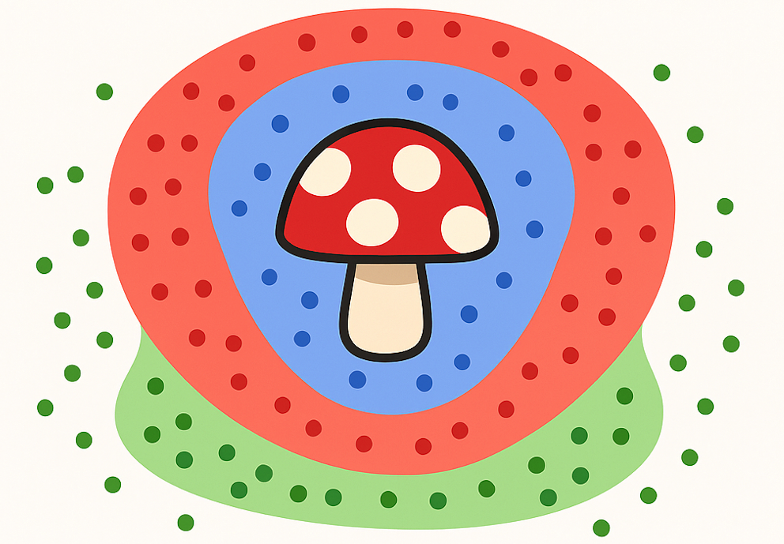

# Neurotical — Neural Networks in the Browser

<p align="center">

</p>

**Neurotical** is an interactive demo that visualizes how neural networks learn.  
It’s built entirely in the browser using **vanilla JavaScript**, no libraries or frameworks required.

You can train models on simple 2D datasets and the MNIST digit dataset, and explore concepts like gradient descent, hidden layers, and backpropagation.

**Live Demo**: https://neurotical.vercel.app

**YouTube**: https://www.youtube.com/watch?v=ePokoTAbEcY

## Features

- **One Neuron** – learn an exam pass/fail cutoff by adjusting a single bias
- **AI Mycologist** – a fun 2D classifier (safe, poisonous, magical)
- **MNIST Digit Classifier** – image-based digit prediction

## First example: raw sum, bias only, Difference loss

Open [the one-neuron demo](./one-neuron/) and start with these settings:

- **Training data:** `set-1`
- **Loss:** Difference
- **Train:** Bias only (weight = 1)
- **Activation:** Raw sum (linear)
- **Learn rate:** `0.1`

The job is to find a cutoff that separates failing exam scores from passing ones. In `set-1`, the highest fail is **55%** and the lowest pass is **65%**.

### 1. Turn a score into an input

The demo scales exam scores from 0–100 to −1–1:

```js
input = score / 50 - 1;
```

For example, 50% becomes `0`, 55% becomes `0.1`, and 65% becomes `0.3`.

### 2. Compute the raw sum and make a decision

The weight stays at `1`. Only the bias changes:

```js
sum = input * 1 + bias;
```

A sum **at or above zero predicts pass**. A negative sum predicts fail. The sum is a raw number, not a probability.

The cutoff is the exam score where the sum reaches zero:

```js
cutoffPercent = (1 - bias) * 50;
```

At bias `0`, the cutoff is 50%. At bias `-0.2`, it is 60%. Making the bias more negative moves the cutoff to the right.

### 3. Measure the loss

The data stores fail as `0` and pass as `1`. For Difference loss, these become directions: `-1` for fail and `+1` for pass.

```js
direction = label * 2 - 1;
exampleLoss = Math.max(0, -direction * sum);
```

This is **perceptron loss**. It penalizes a sum on the wrong side of zero. A sum on the correct side contributes zero, regardless of how far it is from the cutoff. The directions tell us which side is correct; the output does not have to equal −1 or +1.

For the two examples closest to the gap:

| Score | Actual result | Sum at bias 0 | Loss | Sum at bias −0.2 | Loss |
|---|---|---:|---:|---:|---:|
| 55% | Fail | 0.1 | 0.1 | −0.1 | 0 |
| 65% | Pass | 0.3 | 0 | 0.1 | 0 |

The displayed **cost** is the average loss over all training examples. **Accuracy** counts correct pass/fail decisions. They measure different things.

### 4. Train the bias

Each training step tries the bias slightly above and below its current value (`h = 0.0001`) and measures the average cost:

```js
gradient = (costAtBiasPlusH - costAtBiasMinusH) / (2 * h);
newBias = bias - learnRate * gradient;
```

This is finite-difference training. Each step uses the selected learning rate directly. A larger learning rate can move the cutoff too far; a smaller one makes smaller updates.

Initially, 55% is incorrectly predicted to pass. Reducing the bias moves the cutoff right and reduces that example's loss. At bias `-0.2`, the cutoff is 60%, all examples are correct, and the cost is zero.

### 5. Understand why training stops

Difference loss does not prefer the middle of the gap. Any cutoff strictly between 55% and 65% gives zero cost and 100% accuracy. Once the small bias perturbations also stay inside that gap, the gradient is zero and training stops moving the bias. A 60% cutoff is one valid answer, not a target supplied to the neuron.

At exactly zero, an example's loss is also zero, but the prediction rule chooses pass. A failing example exactly on the cutoff can therefore have zero loss while still counting as incorrect.

With **blended** enabled, colors interpolate the raw sum. Since the weight is fixed, training can move this color transition but cannot make it steeper. Uncheck blended to see the sharp pass/fail decision.

## Downloads

- **200 batch training set**: https://storage.googleapis.com/neurotical-mnist/batches.json

---

Inspired by [Sebastian Lague](https://www.youtube.com/watch?v=hfMk-kjRv4c).
